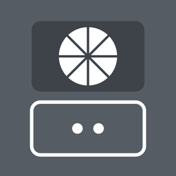

#  iMoonlight

A Moonlight client for iPhone that adds a **portrait mode**: your PC's screen fills the top of
the phone, and the rest becomes a laptop-style **trackpad** with a **keyboard** button, working
like [ThorPad](https://github.com/ajhockey88/ThorPad). Turn the phone sideways and it's regular
full-screen Moonlight.

It's built on [Moonlight for iOS](https://github.com/moonlight-stream/moonlight-ios) and connects
to the same hosts: [Sunshine](https://github.com/LizardByte/Sunshine) (or Apollo) on your Windows PC.

## Portrait mode

Hold the phone upright while streaming. Along the top of the trackpad is a bar with
**⌨️ Keyboard**, **🖥️ PC keys**, **🚫 Video off**, **⚙️ Settings** and **✖️ Disconnect**.

**🚫 Video off** stops the picture but stays connected, so the trackpad and keyboard keep
controlling the PC and the trackpad takes over the whole screen. Turn the phone sideways
while the video is off and the keyboard fills most of the screen, with a narrow trackpad on
the right; swipe down from the top of the trackpad to show the bar.
**🎥 Video on** brings the picture back.

| On the trackpad | On the PC |
|---|---|
| ☝️ Slide one finger | Moves the pointer (faster flicks travel further) |
| 👆 Tap | Left click (a tap still counts if your finger rolls a little) |
| ✊ Tap, then quickly touch again, pause a moment, and slide | Drag (press, move, release) |
| 🤞 Press and hold, or two-finger tap | Right click |
| ✌️ Two fingers up or down | Scroll |
| 🤏 Spread two fingers apart / pinch them together | Zoom in (bigger text) / zoom out (Ctrl + mouse wheel) |
| 👉 / 👈 Two fingers swiped right / left | Back / forward (Alt+← / Alt+→) |
| 🤟 Three fingers swiped up | Task view (Win+Tab) |
| 🤟 Three fingers swiped down | Show the desktop (Win+D) |
| 🤟 Three fingers swiped left or right | Switch app (Alt+Tab) |

Settings can list these gestures along the bottom of the trackpad in three columns (**Finger hints**, off by default).
Every action gives a haptic tap.

- ⌨️ **Keyboard** opens along the bottom, taking up about as much room as the iPhone's own
  keyboard, with the trackpad still usable above it. Keys type the moment your finger
  lands (Settings can switch this to "type when the finger lifts"), each finger is tracked
  separately, and every press flashes and buzzes. **?123** and **=\<** switch to numbers,
  symbols, Esc, Tab and arrow keys. Tap ⇧ once for one capital letter, or twice quickly for caps
  lock. A new sentence starts with a capital letter, and tapping space twice types ". ".
  Hold ⌫ to keep deleting; while you hold it, the space bar turns red and says
  **Clear all** (Ctrl+A, then Backspace). **✕ Close** returns to the trackpad.
- ✋ **Hand button** (portrait, left of the keyboard's preview strip): hold it and one finger on the
  trackpad counts as two, so sliding up or down scrolls, swiping left goes back and swiping right
  goes forward, and a quick tap right-clicks.
- ✨ **Autocorrect** (on by default, the same engine as ThorPad) fixes a misspelled word when you
  finish it with a space or punctuation. It weighs how common each word is, how often it follows
  the word before, and how easy the slip was (neighbouring keys count as small slips). It splits
  words run together by a missed space bar ("helloworld" or "seebyou" becomes "hello world" or
  "see you"), adds apostrophes ("dont" becomes "don't", and "its" or "ill" become "it's" or
  "I'll" where that's what's meant), and fixes mixed-up words when the word before makes it plain
  ("more then" becomes "more than"). Chat shorthand like "lol" or "brb" is left alone. While you
  type, the strip shows "→ correction"; tap it to keep your spelling. Backspace right after a
  correction undoes it. Either way the word is remembered and not corrected again.
- 🖥️ **PC keys**: Esc, F1 to F12, Alt+Tab, Win+Tab, Win+D, Alt+F4, Ctrl+Shift+Esc, Print Screen,
  Home / End / Page Up / Page Down / Delete / Backspace and arrows. Ctrl, Alt, Shift and Win stay
  held after a tap and go with the next key, for any combo. **ABC** switches to the keyboard.
- ⚙️ **Settings**: pointer speed and acceleration, scroll speed, pinch zoom speed, classic scroll direction,
  swap screens (trackpad on top), finger hints, dim when idle, autocorrect, auto-capitalization, the "." shortcut, type when
  the finger lifts, and a
  feel (Off, Tick, Click, Heavy, Double, Buzz) and strength for every haptic.

Touching the stream itself still works like Moonlight's own touch mode, and tapping with three
fingers on the stream opens the iPhone keyboard.

## Install on your iPhone (from a Windows PC)

You don't need a Mac or the App Store. GitHub builds the app for you, and you install it with
your own free Apple ID.

1. **Get the app file (`iMoonlight.ipa`).** Open the
   [latest release](https://github.com/ajhockey88/iMoonlight/releases/tag/latest) and download
   `iMoonlight.ipa`. (Builds from branches and pull requests are under
   [Actions](https://github.com/ajhockey88/iMoonlight/actions): open a run and download the
   `iMoonlight-ipa` artifact, then unzip it.)
2. **Install [Sideloadly](https://sideloadly.io)** on your PC. It needs Apple's iTunes and
   iCloud for Windows, the versions from apple.com rather than the Microsoft Store; Sideloadly's
   site links them.
3. Plug the iPhone into the PC with a cable, unlock it and tap **Trust**.
4. In Sideloadly, drag in `iMoonlight.ipa`, enter your Apple ID, and click **Start**. Enter
   the code Apple sends if it asks.
5. On the iPhone: **Settings > General > VPN & Device Management**, tap your Apple ID under
   Developer App and tap **Trust**.
6. iOS 16 or later: **Settings > Privacy & Security > Developer Mode**, turn it on and restart
   when asked.
7. Open **iMoonlight**, allow it to find devices on your local network, and add your PC as you
   would in Moonlight (it finds Sunshine automatically, or tap + and type the PC's IP address).

With a free Apple ID the app stops opening after **7 days**. Re-run step 4 (no need to delete
the app; your paired PCs stay), or turn on Sideloadly's auto-refresh. AltStore or SideStore work
too and can refresh over Wi-Fi.

## Building

GitHub Actions builds `iMoonlight.ipa` on every push (see `.github/workflows/build-ipa.yml`);
pushes to `main` also update the `latest` release. To build on a Mac instead:

```
git clone --recursive https://github.com/ajhockey88/iMoonlight.git
```

Then open `Moonlight.xcodeproj`, pick your team under Signing & Capabilities for the
"Moonlight" target, and run it on your iPhone.

The portrait trackpad lives in `Limelight/Trackpad/`; `StreamFrameViewController` lays out the
stream and the trackpad for each orientation.

## Credits and license

- Based on [moonlight-ios](https://github.com/moonlight-stream/moonlight-ios) by the Moonlight
  Game Streaming Project, licensed under the GPLv3 (see `LICENSE.txt`). iMoonlight is GPLv3 too.
- Trackpad, keyboard, PC keys and autocorrect are ported from
  [ThorPad](https://github.com/ajhockey88/ThorPad).
- The autocorrect dictionary (`Limelight/Trackpad/words.txt`) takes its spellings from SCOWL's
  American English word list and its word frequencies from
  [wordfreq](https://github.com/rspeer/wordfreq) (data licensed CC BY-SA 4.0).
- Which words follow which (`Limelight/Trackpad/pairs.txt`) comes from ThorPad, built from
  [SymSpell](https://github.com/mammothb/symspellpy)'s bigram list (MIT), drawn from Google Books
  Ngram (CC BY 3.0).
